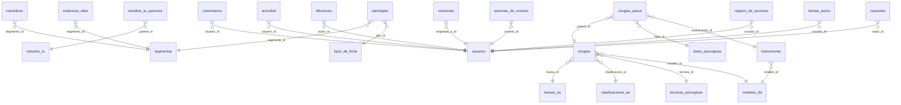

# Esquema de las bases de datos locales

Generado el 21 de octubre de 2026 desde PostgreSQL en `127.0.0.1:5432`. Es una foto de la base **local** de desarrollo: los datos son de prueba y no son los del servidor.

## 1. Qué hay en el servidor local

| Base | Tamaño | Qué es |
|---|---|---|
| `trauma` | 50 MB | **La de TraumaHub.** La usa la aplicación (`DATABASE_URI` en `.env`). Detalle abajo. |
| `postgres` | 8 MB | La que trae PostgreSQL por omisión. Vacía: no la usa ningún proyecto. |

`trauma` tiene **176 tablas**, 251 claves foráneas y 65.995 filas (65.410 son del registro de acciones). El esquema lo crea y mantiene **Payload CMS** a partir de las colecciones de `src/collections`. con 13 migraciones aplicadas (`src/migrations`).

### Cómo leer los nombres de las tablas

Payload parte cada colección en varias tablas, y de ahí salen las 176:

| Patrón | Qué es | Ejemplo |
|---|---|---|
| `nombre` | La colección: una fila por documento. | `patologias` |
| `nombre_blocks_*` | Los **bloques** de contenido de una ficha (texto, imagen, tabla…), una tabla por tipo de bloque. | `patologias_blocks_texto` |
| `nombre_<campo>` | Un campo de tipo lista dentro del documento (pasos, piezas, filas…). | `cirugias_pasos` |
| `nombre_rels` | Las **relaciones** del documento con otros (un campo que apunta a otra colección). | `cirugias_rels` |
| `_nombre_v*` | Las **versiones** (historial y borradores) de la colección. | `_cirugias_v` |
| `payload_*` | Tablas internas de Payload: migraciones, preferencias, documentos bloqueados. | `payload_migrations` |

## 2. Mapa de relaciones entre colecciones

Cada flecha es una clave foránea directa (columna `…_id`). Las relaciones de varios valores viven en las tablas `_rels` y no se dibujan.

## 3. Las tablas, por grupo

Para cada colección: filas locales, tamaño total (con sus tablas hijas) y sus columnas propias. `NN` marca las obligatorias.

### Contenido (los cinco módulos y su material)

#### `patologias` — 2 filas · ≈ 2.2 MB · 25 tablas hijas

| Columna | Tipo | | Apunta a |
|---|---|---|---|
| `id` | clave | PK | |
| `nombre` | texto |  |  |
| `subtitulo` | texto |  |  |
| `segmento_id` | entero |  | `segmentos` |
| `codigo` | texto |  |  |
| `updated_at` | fecha y hora | NN |  |
| `created_at` | fecha y hora | NN |  |
| `_status` | lista fija |  |  |
| `tipo_id` | entero |  | `tipos_de_ficha` |

Tablas hijas: `_patologias_v`, `_patologias_v_blocks_advertencia`, `_patologias_v_blocks_imagen`, `_patologias_v_blocks_instancia_atlas`, `_patologias_v_blocks_lista_clinica`, `_patologias_v_blocks_lista_clinica_puntos`, `_patologias_v_blocks_modelo_3d`, `_patologias_v_blocks_tabla_clasificacion`, `_patologias_v_blocks_tabla_clasificacion_filas`, `_patologias_v_blocks_tabla_vera_health`, `_patologias_v_blocks_texto`, `_patologias_v_blocks_video`, `_patologias_v_version_fases`, `patologias_blocks_advertencia` y 11 más.

#### `maniobras` — 3 filas · ≈ 1.2 MB · 23 tablas hijas

| Columna | Tipo | | Apunta a |
|---|---|---|---|
| `id` | clave | PK | |
| `nombre` | texto |  |  |
| `segmento_id` | entero |  | `segmentos` |
| `evalua` | texto |  |  |
| `tecnica` | json |  |  |
| `positivo` | json |  |  |
| `nota` | json |  |  |
| `updated_at` | fecha y hora | NN |  |
| `created_at` | fecha y hora | NN |  |
| `_status` | lista fija |  |  |

Tablas hijas: `_maniobras_v`, `_maniobras_v_blocks_advertencia`, `_maniobras_v_blocks_imagen`, `_maniobras_v_blocks_instancia_atlas`, `_maniobras_v_blocks_lista_clinica`, `_maniobras_v_blocks_lista_clinica_puntos`, `_maniobras_v_blocks_modelo_3d`, `_maniobras_v_blocks_tabla_clasificacion`, `_maniobras_v_blocks_tabla_clasificacion_filas`, `_maniobras_v_blocks_tabla_vera_health`, `_maniobras_v_blocks_texto`, `_maniobras_v_blocks_video`, `maniobras_blocks_advertencia`, `maniobras_blocks_imagen` y 9 más.

#### `casos_ao` — 2 filas · ≈ 1.4 MB · 25 tablas hijas

| Columna | Tipo | | Apunta a |
|---|---|---|---|
| `id` | clave | PK | |
| `titulo` | texto |  |  |
| `codigo` | texto |  |  |
| `procedimiento` | json |  |  |
| `updated_at` | fecha y hora | NN |  |
| `created_at` | fecha y hora | NN |  |
| `_status` | lista fija |  |  |
| `tratamiento` | lista fija |  |  |

Tablas hijas: `_casos_ao_v`, `_casos_ao_v_blocks_advertencia`, `_casos_ao_v_blocks_imagen`, `_casos_ao_v_blocks_instancia_atlas`, `_casos_ao_v_blocks_lista_clinica`, `_casos_ao_v_blocks_lista_clinica_puntos`, `_casos_ao_v_blocks_modelo_3d`, `_casos_ao_v_blocks_tabla_clasificacion`, `_casos_ao_v_blocks_tabla_clasificacion_filas`, `_casos_ao_v_blocks_tabla_vera_health`, `_casos_ao_v_blocks_texto`, `_casos_ao_v_blocks_video`, `_casos_ao_v_version_pasos`, `casos_ao_blocks_advertencia` y 11 más.

#### `cirugias` — 3 filas · ≈ 2.2 MB · 30 tablas hijas

| Columna | Tipo | | Apunta a |
|---|---|---|---|
| `id` | clave | PK | |
| `nombre` | texto |  |  |
| `codigo` | texto |  |  |
| `resumen` | json |  |  |
| `updated_at` | fecha y hora | NN |  |
| `created_at` | fecha y hora | NN |  |
| `_status` | lista fija |  |  |
| `hueso_id` | entero |  | `huesos_ao` |
| `clasificacion_id` | entero |  | `clasificaciones_ao` |
| `tecnica_id` | entero |  | `tecnicas_quirurgicas` |
| `modelo_id` | entero |  | `modelos_3d` |
| `milimetros_por_unidad` | número |  |  |
| `eje_largo` | lista fija |  |  |
| `desplazamiento_inicial_x` | número |  |  |
| `desplazamiento_inicial_y` | número |  |  |
| `desplazamiento_inicial_z` | número |  |  |
| `desplazamiento_inicial_giro_x` | número |  |  |
| `desplazamiento_inicial_giro_y` | número |  |  |
| `desplazamiento_inicial_giro_z` | número |  |  |
| `bandeja` | lista fija |  |  |

Tablas hijas: `_cirugias_v`, `_cirugias_v_blocks_advertencia`, `_cirugias_v_blocks_imagen`, `_cirugias_v_blocks_instancia_atlas`, `_cirugias_v_blocks_lista_clinica`, `_cirugias_v_blocks_lista_clinica_puntos`, `_cirugias_v_blocks_modelo_3d`, `_cirugias_v_blocks_tabla_clasificacion`, `_cirugias_v_blocks_tabla_clasificacion_filas`, `_cirugias_v_blocks_tabla_vera_health`, `_cirugias_v_blocks_texto`, `_cirugias_v_blocks_video`, `_cirugias_v_rels`, `_cirugias_v_version_pasos` y 16 más.

#### `estudios_ia` — 2 filas · ≈ 1.6 MB · 29 tablas hijas

| Columna | Tipo | | Apunta a |
|---|---|---|---|
| `id` | clave | PK | |
| `nombre` | texto |  |  |
| `codigo` | texto |  |  |
| `confianza` | número |  |  |
| `updated_at` | fecha y hora | NN |  |
| `created_at` | fecha y hora | NN |  |
| `_status` | lista fija |  |  |

Tablas hijas: `_estudios_ia_v`, `_estudios_ia_v_blocks_advertencia`, `_estudios_ia_v_blocks_imagen`, `_estudios_ia_v_blocks_instancia_atlas`, `_estudios_ia_v_blocks_lista_clinica`, `_estudios_ia_v_blocks_lista_clinica_puntos`, `_estudios_ia_v_blocks_modelo_3d`, `_estudios_ia_v_blocks_tabla_clasificacion`, `_estudios_ia_v_blocks_tabla_clasificacion_filas`, `_estudios_ia_v_blocks_tabla_vera_health`, `_estudios_ia_v_blocks_texto`, `_estudios_ia_v_blocks_video`, `_estudios_ia_v_version_hallazgos`, `_estudios_ia_v_version_opciones` y 15 más.

### Catálogos y material de apoyo

#### `segmentos` — 10 filas · 96 KB

| Columna | Tipo | | Apunta a |
|---|---|---|---|
| `id` | clave | PK | |
| `nombre` | texto | NN |  |
| `orden` | número |  |  |
| `updated_at` | fecha y hora | NN |  |
| `created_at` | fecha y hora | NN |  |

#### `tipos_de_ficha` — 2 filas · 112 KB

| Columna | Tipo | | Apunta a |
|---|---|---|---|
| `id` | clave | PK | |
| `nombre` | texto | NN |  |
| `orden` | número |  |  |
| `updated_at` | fecha y hora | NN |  |
| `created_at` | fecha y hora | NN |  |

#### `huesos_ao` — 4 filas · 112 KB

| Columna | Tipo | | Apunta a |
|---|---|---|---|
| `id` | clave | PK | |
| `nombre` | texto | NN |  |
| `codigo` | texto |  |  |
| `orden` | número |  |  |
| `updated_at` | fecha y hora | NN |  |
| `created_at` | fecha y hora | NN |  |

#### `clasificaciones_ao` — 7 filas · 112 KB

| Columna | Tipo | | Apunta a |
|---|---|---|---|
| `id` | clave | PK | |
| `codigo` | texto | NN |  |
| `nombre` | texto | NN |  |
| `tipo` | lista fija |  |  |
| `descripcion` | texto |  |  |
| `orden` | número |  |  |
| `updated_at` | fecha y hora | NN |  |
| `created_at` | fecha y hora | NN |  |

#### `tecnicas_quirurgicas` — 5 filas · 112 KB

| Columna | Tipo | | Apunta a |
|---|---|---|---|
| `id` | clave | PK | |
| `nombre` | texto | NN |  |
| `descripcion` | texto |  |  |
| `orden` | número |  |  |
| `updated_at` | fecha y hora | NN |  |
| `created_at` | fecha y hora | NN |  |

#### `fases_quirurgicas` — 4 filas · 112 KB

| Columna | Tipo | | Apunta a |
|---|---|---|---|
| `id` | clave | PK | |
| `nombre` | texto | NN |  |
| `orden` | número |  |  |
| `updated_at` | fecha y hora | NN |  |
| `created_at` | fecha y hora | NN |  |

#### `instrumental` — 27 filas · ≈ 192 KB · 1 tablas hijas

| Columna | Tipo | | Apunta a |
|---|---|---|---|
| `id` | clave | PK | |
| `nombre` | texto | NN |  |
| `icono` | lista fija |  |  |
| `descripcion` | texto |  |  |
| `orden` | número |  |  |
| `updated_at` | fecha y hora | NN |  |
| `created_at` | fecha y hora | NN |  |
| `modelo_id` | entero |  | `modelos_3d` |
| `slug` | texto |  |  |
| `categoria` | lista fija |  |  |
| `especificaciones` | texto |  |  |
| `ajustes` | json |  |  |
| `orificios` | número |  |  |
| `largo_mm` | número |  |  |
| `tipo_de_tornillo` | lista fija |  |  |

Tablas hijas: `instrumental_rels`.

#### `medios` — 1 fila · 144 KB

| Columna | Tipo | | Apunta a |
|---|---|---|---|
| `id` | clave | PK | |
| `alt` | texto | NN |  |
| `updated_at` | fecha y hora | NN |  |
| `created_at` | fecha y hora | NN |  |
| `url` | texto |  |  |
| `thumbnail_u_r_l` | texto |  |  |
| `filename` | texto |  |  |
| `mime_type` | texto |  |  |
| `filesize` | número |  |  |
| `width` | número |  |  |
| `height` | número |  |  |
| `focal_x` | número |  |  |
| `focal_y` | número |  |  |
| `sizes_miniatura_url` | texto |  |  |
| `sizes_miniatura_width` | número |  |  |
| `sizes_miniatura_height` | número |  |  |
| `sizes_miniatura_mime_type` | texto |  |  |
| `sizes_miniatura_filesize` | número |  |  |
| `sizes_miniatura_filename` | texto |  |  |
| `sizes_ancho_url` | texto |  |  |
| `sizes_ancho_width` | número |  |  |
| `sizes_ancho_height` | número |  |  |
| `sizes_ancho_mime_type` | texto |  |  |
| `sizes_ancho_filesize` | número |  |  |
| `sizes_ancho_filename` | texto |  |  |

#### `modelos_3d` — 17 filas · 152 KB

| Columna | Tipo | | Apunta a |
|---|---|---|---|
| `id` | clave | PK | |
| `nombre` | texto | NN |  |
| `origen` | lista fija | NN |  |
| `anonimizado` | sí/no |  |  |
| `triangulos` | número |  |  |
| `notas` | texto |  |  |
| `updated_at` | fecha y hora | NN |  |
| `created_at` | fecha y hora | NN |  |
| `url` | texto |  |  |
| `thumbnail_u_r_l` | texto |  |  |
| `filename` | texto |  |  |
| `mime_type` | texto |  |  |
| `filesize` | número |  |  |
| `width` | número |  |  |
| `height` | número |  |  |
| `focal_x` | número |  |  |
| `focal_y` | número |  |  |
| `encuadre_escala` | número |  |  |
| `encuadre_giro_x` | número |  |  |
| `encuadre_giro_y` | número |  |  |
| `encuadre_giro_z` | número |  |  |
| `encuadre_distancia_camara` | número |  |  |
| `clase` | lista fija | NN |  |

#### `instancias_atlas` — 2 filas · 160 KB

| Columna | Tipo | | Apunta a |
|---|---|---|---|
| `id` | clave | PK | |
| `nombre` | texto | NN |  |
| `descripcion` | texto |  |  |
| `segmento_id` | entero |  | `segmentos` |
| `numero_de_piezas` | número |  |  |
| `contenido` | json | NN |  |
| `atlas_version` | texto |  |  |
| `updated_at` | fecha y hora | NN |  |
| `created_at` | fecha y hora | NN |  |

#### `estructuras_anatomicas` — 0 filas · ≈ 3.8 MB · 1 tablas hijas

| Columna | Tipo | | Apunta a |
|---|---|---|---|
| `id` | clave | PK | |
| `atlas_id` | texto | NN |  |
| `nombre_original` | texto | NN |  |
| `sistema` | texto |  |  |
| `region` | texto |  |  |
| `lado` | texto |  |  |
| `nombre_latino` | texto |  |  |
| `definicion` | texto |  |  |
| `origen` | texto |  |  |
| `insercion` | texto |  |  |
| `inervacion` | texto |  |  |
| `accion` | texto |  |  |
| `irrigacion` | texto |  |  |
| `notas` | texto |  |  |
| `oculta` | sí/no |  |  |
| `huerfana` | sí/no |  |  |
| `updated_at` | fecha y hora | NN |  |
| `created_at` | fecha y hora | NN |  |
| `abordaje_cortar` | texto |  |  |
| `abordaje_separar` | texto |  |  |

Tablas hijas: `_estructuras_anatomicas_v`.

### Personas y permisos

#### `usuarios` — 14 filas · ≈ 440 KB · 3 tablas hijas

| Columna | Tipo | | Apunta a |
|---|---|---|---|
| `id` | clave | PK | |
| `nombre` | texto | NN |  |
| `rol` | lista fija | NN |  |
| `activo` | sí/no |  |  |
| `institucion` | texto |  |  |
| `ultimo_acceso` | fecha y hora |  |  |
| `notas` | texto |  |  |
| `updated_at` | fecha y hora | NN |  |
| `created_at` | fecha y hora | NN |  |
| `email` | texto | NN |  |
| `reset_password_token` | texto |  |  |
| `reset_password_expiration` | fecha y hora |  |  |
| `salt` | texto |  |  |
| `hash` | texto |  |  |
| `login_attempts` | número |  |  |
| `lock_until` | fecha y hora |  |  |
| `origen` | lista fija |  |  |
| `pendiente` | sí/no |  |  |
| `motivo_de_solicitud` | texto |  |  |
| `solicitada_en` | fecha y hora |  |  |
| `reset_password_requested_at` | fecha y hora |  |  |

Tablas hijas: `usuarios_modulos_editables`, `usuarios_modulos_visibles`, `usuarios_sessions`.

### Seguimiento: lectura, revisión y actividad

#### `actividad` — 6 filas · ≈ 192 KB · 1 tablas hijas

| Columna | Tipo | | Apunta a |
|---|---|---|---|
| `id` | clave | PK | |
| `usuario_id` | entero | NN | `usuarios` |
| `coleccion` | lista fija | NN |  |
| `documento_id` | texto | NN |  |
| `ultima_visita` | fecha y hora |  |  |
| `completado` | sí/no |  |  |
| `updated_at` | fecha y hora | NN |  |
| `created_at` | fecha y hora | NN |  |
| `puntaje` | número |  |  |
| `puntaje_maximo` | número |  |  |
| `insumos` | json |  |  |
| `reduccion_automatica` | sí/no |  |  |
| `radiografia` | json |  |  |

Tablas hijas: `actividad_complicaciones`.

#### `tiempo_activo` — 7 filas · 144 KB

| Columna | Tipo | | Apunta a |
|---|---|---|---|
| `id` | clave | PK | |
| `usuario_id` | entero |  | `usuarios` |
| `dia` | texto | NN |  |
| `segundos` | número |  |  |
| `latidos` | número |  |  |
| `por_hora` | json |  |  |
| `ultimo_latido` | fecha y hora |  |  |
| `ultima_ruta` | texto |  |  |
| `updated_at` | fecha y hora | NN |  |
| `created_at` | fecha y hora | NN |  |

#### `revisiones` — 1 fila · ≈ 400 KB · 1 tablas hijas

| Columna | Tipo | | Apunta a |
|---|---|---|---|
| `id` | clave | PK | |
| `coleccion` | lista fija | NN |  |
| `documento_id` | texto | NN |  |
| `titulo` | texto |  |  |
| `origen` | lista fija | NN |  |
| `libro` | texto |  |  |
| `capitulo` | texto |  |  |
| `paginas` | texto |  |  |
| `lote` | texto |  |  |
| `modelo` | texto |  |  |
| `archivo_fuente` | texto |  |  |
| `notas_para_el_revisor` | json |  |  |
| `estado` | lista fija | NN |  |
| `asignada_a_id` | entero |  | `usuarios` |
| `original` | json |  |  |
| `palabras_originales` | número |  |  |
| `palabras_actuales` | número |  |  |
| `palabras_quitadas` | número |  |  |
| `palabras_nuevas` | número |  |  |
| `porcentaje_editado` | número |  |  |
| `por_seccion` | json |  |  |
| `ultima_edicion` | fecha y hora |  |  |
| `ultimo_editor_id` | entero |  | `usuarios` |
| `lista_por_id` | entero |  | `usuarios` |
| `lista_en` | fecha y hora |  |  |
| `segundos_activos_al_validar` | número |  |  |
| `segundos_abiertos_al_validar` | número |  |  |
| `porcentaje_al_validar` | número |  |  |
| `ritmo_al_validar` | número |  |  |
| `secciones_vistas_al_validar` | número |  |  |
| `secciones_con_contenido` | número |  |  |
| `validacion_rapida` | sí/no |  |  |
| `motivos_de_alerta` | texto |  |  |
| `nota_de_revision` | texto |  |  |
| `motivo_de_devolucion` | texto |  |  |
| `devoluciones` | número |  |  |
| `publicada_en` | fecha y hora |  |  |
| `publicada_por_id` | entero |  | `usuarios` |
| `publicada_sin_validar` | sí/no |  |  |
| `updated_at` | fecha y hora | NN |  |
| `created_at` | fecha y hora | NN |  |

Tablas hijas: `revisiones_historial`.

#### `sesiones_de_revision` — 1 fila · 176 KB

| Columna | Tipo | | Apunta a |
|---|---|---|---|
| `id` | clave | PK | |
| `usuario_id` | entero |  | `usuarios` |
| `coleccion` | lista fija | NN |  |
| `documento_id` | texto | NN |  |
| `sesion` | texto | NN |  |
| `inicio` | fecha y hora |  |  |
| `ultimo_latido` | fecha y hora |  |  |
| `segundos_abiertos` | número |  |  |
| `segundos_activos` | número |  |  |
| `por_seccion` | json |  |  |
| `ediciones` | número |  |  |
| `guardados` | número |  |  |
| `updated_at` | fecha y hora | NN |  |
| `created_at` | fecha y hora | NN |  |

#### `registro_de_acciones` — 65410 filas · 20.9 MB

| Columna | Tipo | | Apunta a |
|---|---|---|---|
| `id` | clave | PK | |
| `fecha` | fecha y hora | NN |  |
| `usuario_id` | entero |  | `usuarios` |
| `usuario_nombre` | texto |  |  |
| `usuario_correo` | texto |  |  |
| `rol` | texto |  |  |
| `permisos` | json |  |  |
| `accion` | texto | NN |  |
| `coleccion` | texto |  |  |
| `documento_id` | texto |  |  |
| `titulo` | texto |  |  |
| `detalle` | texto |  |  |
| `cambios` | json |  |  |
| `origen` | texto |  |  |
| `updated_at` | fecha y hora | NN |  |
| `created_at` | fecha y hora | NN |  |

### Comunicación y ajustes

#### `comentarios` — 0 filas · 104 KB

| Columna | Tipo | | Apunta a |
|---|---|---|---|
| `id` | clave | PK | |
| `usuario_id` | entero |  | `usuarios` |
| `coleccion` | lista fija | NN |  |
| `documento_id` | texto | NN |  |
| `texto` | texto | NN |  |
| `estado` | lista fija | NN |  |
| `updated_at` | fecha y hora | NN |  |
| `created_at` | fecha y hora | NN |  |
| `ancla` | json |  |  |

#### `difusiones` — 0 filas · 112 KB

| Columna | Tipo | | Apunta a |
|---|---|---|---|
| `id` | clave | PK | |
| `asunto` | texto | NN |  |
| `mensaje` | texto | NN |  |
| `boton_texto` | texto |  |  |
| `boton_enlace` | texto |  |  |
| `audiencia` | lista fija | NN |  |
| `autor_id` | entero |  | `usuarios` |
| `estado` | lista fija | NN |  |
| `total` | número | NN |  |
| `enviados` | número | NN |  |
| `fallidos` | número | NN |  |
| `pendientes` | json |  |  |
| `fallos` | json |  |  |
| `terminada_en` | fecha y hora |  |  |
| `updated_at` | fecha y hora | NN |  |
| `created_at` | fecha y hora | NN |  |

#### `requisitos` — 0 filas · ≈ 192 KB · 1 tablas hijas

| Columna | Tipo | | Apunta a |
|---|---|---|---|
| `id` | clave | PK | |
| `titulo` | texto | NN |  |
| `descripcion` | texto | NN |  |
| `modulo` | lista fija | NN |  |
| `autor_id` | entero |  | `usuarios` |
| `estado` | lista fija | NN |  |
| `respuesta` | texto |  |  |
| `updated_at` | fecha y hora | NN |  |
| `created_at` | fecha y hora | NN |  |

Tablas hijas: `requisitos_rels`.

#### `ajustes` — 0 filas · ≈ 144 KB · 1 tablas hijas

| Columna | Tipo | | Apunta a |
|---|---|---|---|
| `id` | clave | PK | |
| `nombre` | texto |  |  |
| `updated_at` | fecha y hora | NN |  |
| `created_at` | fecha y hora | NN |  |

Tablas hijas: `ajustes_modulos_en_mantencion`.

### Otras

#### `cirugias_pasos` — 8 filas · ≈ 264 KB · 1 tablas hijas

| Columna | Tipo | | Apunta a |
|---|---|---|---|
| `_order` | entero | NN |  |
| `_parent_id` | entero | NN | `cirugias` |
| `id` | clave | PK | |
| `titulo` | texto |  |  |
| `descripcion` | json |  |  |
| `fuerza_minima` | número |  |  |
| `fuerza_maxima` | número |  |  |
| `exito` | texto |  |  |
| `insuficiente` | texto |  |  |
| `excesivo` | texto |  |  |
| `riesgo` | json |  |  |
| `fase_id` | entero |  | `fases_quirurgicas` |
| `objetivo` | lista fija |  |  |
| `instrumento_id` | entero |  | `instrumental` |
| `puntos` | número |  |  |
| `trazo_minimo` | número |  |  |
| `trazo_maximo` | número |  |  |
| `tolerancia_desplazamiento` | número |  |  |
| `tolerancia_angulacion` | número |  |  |
| `tolerancia_diastasis` | número |  |  |
| `instrumento_propuesto` | texto |  |  |
| `calibre_broca` | número |  |  |
| `angulo_minimo` | número |  |  |
| `angulo_maximo` | número |  |  |
| `tornillos_minimos` | número |  |  |
| `exige_bicortical` | sí/no |  |  |
| `musculo_del_plano` | texto |  |  |
| `accion_del_plano` | lista fija |  |  |
| `exige_compresion` | sí/no |  |  |

Tablas hijas: `cirugias_pasos_muestra`.

#### `estudios_ia_opciones` — 2 filas · ≈ 192 KB · 2 tablas hijas

| Columna | Tipo | | Apunta a |
|---|---|---|---|
| `_order` | entero | NN |  |
| `_parent_id` | entero | NN | `estudios_ia` |
| `id` | clave | PK | |
| `titulo` | texto |  |  |
| `frecuente` | sí/no |  |  |

Tablas hijas: `estudios_ia_opciones_a_favor`, `estudios_ia_opciones_en_contra`.

## 4. Tablas internas de Payload

| Tabla | Para qué | Filas |
|---|---|---|
| `payload_migrations` | Qué migraciones se aplicaron. La fila con `batch = -1` marca que se arrancó en modo desarrollo. | 13 |
| `payload_preferences` | Preferencias de interfaz por usuario. | 0 |
| `payload_locked_documents` | Documentos que alguien tiene abiertos para editar. | 0 |
| `payload_kv` | Pares clave-valor internos. | 0 |

## 5. Cosas que conviene saber

- **La base local no tiene cargadas las estructuras anatómicas** (`estructuras_anatomicas`: 0 filas): en el servidor, el administrador las carga con «Cargar las piezas del atlas».
- **Hay datos de prueba**: instrumental y modelos «PRUEBA-LOCAL», una patología «PRUEBA PDF» y filas de actividad. No existen en el servidor.
- `registro_de_acciones` es la tabla que más crece (65 mil filas, 21 MB): es la bitácora de todo lo que hace cada cuenta.
- Para cambiar el esquema se edita la colección en `src/collections` y se crea una migración (`npx payload migrate:create`); no se toca la base a mano.
- Para regenerarlo: este documento sale de consultas a `information_schema` y `pg_constraint`; no hay un guion en el repositorio que lo rehaga.
